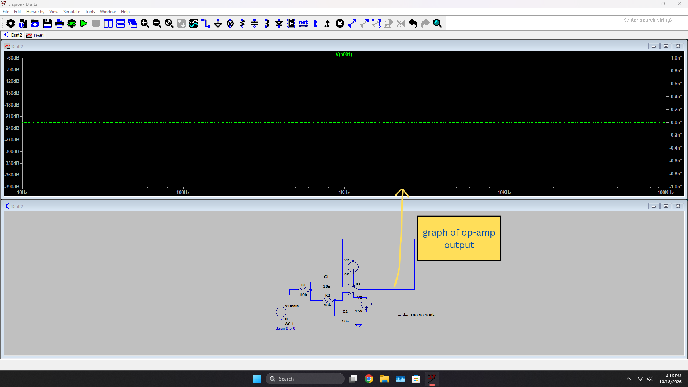

# SALLEN KEY LOW PASS FILTER 793474
The goal of this project was to apply what ive learned over the past few months while studying the khan academy elec e course. But more than that, i wanted to try to create and debug a kind of analog circuit since that is the kind of thing i want to do in college. My focus with the project was to teach myself how to do something akin to an engineering project. Becasue of this, i chose easy resistors and capacitor values of 10 (units) so i could focus purely on design and making sure that the output of my circuit matched the projected value of the target cutoff frequency equations. The text below details the versions of the project and my process.

